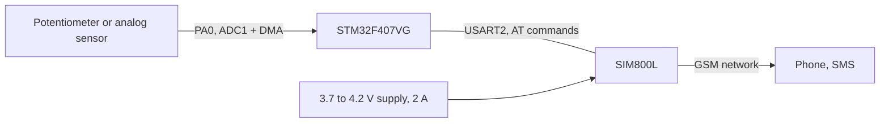

# GSM SMS alarm with SIM800L

STM32F407 · ADC with DMA · AT commands · threshold alert

   [](https://tech-ohm.com)

**English** | [Türkçe](README.tr.md) · An open-source project by [TECH-OHM](https://tech-ohm.com)

An example that sends an SMS through a SIM800L GSM module when an analog value crosses a threshold. I used a potentiometer in place of a sensor. The same structure works as a remote alarm with a temperature, level or pressure sensor.

## Block diagram



## Pins

| MCU pin | Connects to | Notes |
|---|---|---|
| PA0 | potentiometer wiper | ADC1 channel 0 |
| PA2 | SIM800L RXD | USART2 TX, 115200 |
| PA3 | SIM800L TXD | USART2 RX |
| GND | SIM800L GND | common ground |

Do not power the SIM800L from the board's 3.3 V or 5 V pin. The module draws bursts of up to 2 A while registering on the network and needs 3.7 to 4.2 V. Use a separate Li-ion cell or a regulator that can supply the current, with a large capacitor right at the module. If the voltage sags the module keeps rebooting, which is the most common problem with it.

## How it works

The ADC converts continuously with DMA and the latest value sits in `pot1`. The main loop checks it once a second:

- If the value is above 3000 and no SMS has been sent yet, a message goes out.
- When the value drops below 2800 the alarm is re-armed.

The 200-count gap matters. Without it, a value hovering at the threshold would send dozens of messages in a row.

The SMS sequence:

```
AT
AT+CMGF=1                  text mode
AT+CMGS="05XXXXXXXXX"      recipient
UYARI: POT degeri 3000'u gecti!
Ctrl+Z (0x1A)              send
```

## Before you use it

Replace `05XXXXXXXXX` in `main.c` with your own number. The thresholds are in the same place.

## Limitations

- The module's replies are not read. Commands are separated by fixed delays, so the firmware does not notice an `ERROR`.
- Network registration (`AT+CREG?`) is not checked.
- `SIM800_Read_SMS()` exists for reading incoming messages but is not called from the main loop.

## Build

In STM32CubeIDE use `File > Import > Existing Projects into Workspace` and select this folder.

## License

MIT. The STM32 HAL and CMSIS files under `Drivers` keep their own licenses.

## Author

M. Eyüb Can, embedded systems engineer and founder of [TECH-OHM](https://tech-ohm.com)

## About TECH-OHM

[TECH-OHM](https://tech-ohm.com) designs electronic boards and embedded software, from the first schematic to series production. We also run a 12-month embedded systems training program and consult for engineering teams.

Web: [tech-ohm.com](https://tech-ohm.com) · Email: info@tech-ohm.com
