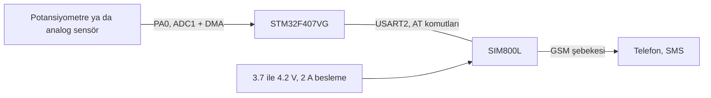

# STM32F407 ve SIM800L ile eşik aşımında SMS uyarısı

Analog bir değer belirlenen eşiği geçtiğinde SIM800L GSM modülü üzerinden SMS gönderen örnek. Denemede sensör yerine potansiyometre kullandım. Aynı yapı sıcaklık, seviye ya da basınç sensörüyle uzaktan alarm için kullanılabilir.

## Blok diyagram



## Pinler

| Kart pini | Bağlandığı yer | Açıklama |
|---|---|---|
| PA0 | potansiyometre orta ucu | ADC1 kanal 0 |
| PA2 | SIM800L RXD | USART2 TX, 115200 |
| PA3 | SIM800L TXD | USART2 RX |
| GND | SIM800L GND | ortak toprak |

SIM800L'i kartın 3.3 V ya da 5 V pininden besleme. Modül şebekeye bağlanırken 2 A'e kadar anlık akım çekiyor ve 3.7 ile 4.2 V arası istiyor. Ayrı bir Li-ion pil ya da akımı yeten bir regülatör kullan, beslemenin dibine de büyük bir kondansatör koy. Gerilim çöktüğünde modül sürekli yeniden başlar, en sık yaşanan sorun bu.

## Nasıl çalışıyor

ADC, DMA ile sürekli çevrim yapıyor ve son değer `pot1` değişkeninde duruyor. Ana döngü saniyede bir bu değere bakıyor:

- Değer 3000'i geçtiyse ve daha önce SMS atılmadıysa mesaj gönderiliyor.
- Değer 2800'ün altına inince sistem yeniden kuruluyor.

Aradaki 200 birimlik fark önemli. Olmasaydı değer eşik civarında gezinirken art arda onlarca SMS giderdi.

SMS gönderme sırası:

```
AT
AT+CMGF=1                  metin modu
AT+CMGS="05XXXXXXXXX"      alıcı numarası
UYARI: POT degeri 3000'u gecti!
Ctrl+Z (0x1A)              mesajı gönder
```

## Kullanmadan önce

`main.c` içindeki `05XXXXXXXXX` yerine kendi numaranı yaz. Eşikleri de aynı yerde değiştirebilirsin.

## Eksikler

- Modülün cevapları okunmuyor, komutlar arasında sabit süre bekleniyor. Modül `ERROR` dönse de yazılım fark etmiyor.
- Şebekeye kayıt (`AT+CREG?`) kontrol edilmiyor.
- `SIM800_Read_SMS()` fonksiyonu gelen mesajı okumak için yazılı, ama ana döngüden çağrılmıyor.

## Derleme

STM32CubeIDE'de `File > Import > Existing Projects into Workspace` ile klasörü seç. İşlemci STM32F407VG.

## Lisans

MIT. `Drivers` klasöründeki STM32 HAL ve CMSIS dosyaları kendi lisanslarıyla gelir.

## Yazar

Gömülü Sistem Mühendisi M. Eyüb Can, [TECH-OHM](https://tech-ohm.com)
